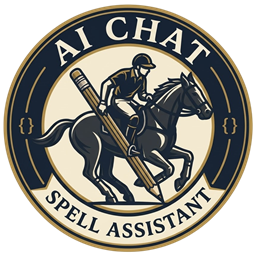

# AI Chat Spell Assistant

### Official Visual Studio Code Extension

 

**Fix typos, grammar, and context slips directly inside your VS Code AI chat inputs—without breaking code syntax, variables, or functions.**

---

## What It Does

Standard spell checkers only scan open files in your workspace—they completely ignore your chat inputs. When a prompt contains mistyped code identifiers or broken grammar, AI models (Copilot, Cursor, Claude, Antigravity) easily hallucinate or misunderstand your request.

**AI Chat Spell Assistant** runs right inside your editor's chat boxes, correcting your prompts on the fly before you hit enter.

---

## ⚡ Shortcuts

| Shortcut | Mode | Behavior |
| :---: | :--- | :--- |
| <kbd>Alt</kbd> + <kbd>W</kbd> | **Instant Auto-Fix** | **Zero UI.** Automatically captures text from the active chat box, fixes mistakes, and pastes clean text back in place. |
| <kbd>Alt</kbd> + <kbd>Q</kbd> | **Interactive Inspector** | Opens a side-by-side review panel with squiggly highlights and one-click replacement chips. |

---

## 🎯 Real-World Examples

| Prompt (Before) | Corrected Output (<kbd>Alt</kbd> + <kbd>W</kbd>) | What It Resolves |
| :--- | :--- | :--- |
| `can u fix this fucntion resposne pls` | `Can you fix this function response please` | Fixes dev slang & typos |
| `their is a error in this peace of code` | `There is an error in this piece of code` | Fixes contextual homophones |
| `getUserById(userId) is retun undefined` | `getUserById(userId) is returning undefined` | **Preserves code identifier**; fixes verb |

---

## ✨ Key Highlights

* **Code Shield™:** Never ruins code identifiers. Leaves `camelCase`, `snake_case`, inline backticks, API endpoints, and terminal flags untouched.
* **Context-Aware:** Detects real words used in the wrong context (e.g., `loose connection` $\rightarrow$ `lose connection`).
* **100% Local & Private:** Runs entirely on your local machine with zero external network requests. Your prompts and private code never leave your computer.
* **Universal Editor Support:** Works across Copilot Chat, Cursor, Antigravity, Markdown files, and Git commit inputs.

---

## 🚀 Getting Started

1. Open **VS Code** (or **Antigravity IDE**).
2. Go to the Extensions panel (`Ctrl+Shift+X` or `Cmd+Shift+X`).
3. Search for **`AI Chat Spell Assistant`** and click **Install**.
4. In any chat input, type your prompt and press <kbd>Alt</kbd> + <kbd>W</kbd>.

---

Maintained by **ibrahim-adel** • Released under the [MIT License](LICENSE)

