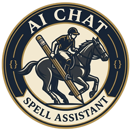

<div align="center">



# AI Chat Spell Assistant

### Stop burning tokens on broken prompts.


<br /><br />

<!-- Action Install Buttons -->
<a href="https://marketplace.visualstudio.com/items?itemName=ibrahim-adel.ai-chat-spell-assistant" title="Install for Cursor & VS Code">
  
</a>
&nbsp;&nbsp;
<a href="https://open-vsx.org/extension/ibrahim-adel/ai-chat-spell-assistant" title="Install for Antigravity & Open VSX">
  
</a>

<br /><br />

<!-- Supported Editors Badges -->


<br /><br />

<!-- Live Dynamic Stats Badges -->
<a href="https://open-vsx.org/extension/ibrahim-adel/ai-chat-spell-assistant">
  
</a>
<a href="https://open-vsx.org/extension/ibrahim-adel/ai-chat-spell-assistant">
  
</a>
<a href="https://marketplace.visualstudio.com/items?itemName=ibrahim-adel.ai-chat-spell-assistant">
  
</a>
<a href="LICENSE">
  
</a>

<br /><br />

<br />

**Code-safe spell and grammar check for Cursor, VS Code, Antigravity, Claude, Codex & Copilot AI chats — fixing typos before hitting Enter without breaking variables, functions, or syntax.**

</div>

> [!IMPORTANT]
> **Stay on the Latest Release**: Updates are frequently rolled out across both VS Code Marketplace and Open VSX to improve chat hook stability. Keep your extension updated to ensure smooth prompt correction!

---

## What It Does

Standard spell checkers only scan open files in your workspace—they completely ignore your chat inputs. When a prompt contains mistyped code identifiers, truncated paths, or broken grammar, AI models (Copilot, Cursor Chat, Claude, Antigravity Agent) easily hallucinate or misunderstand your request.

**AI Chat Spell Assistant** runs right inside your editor's chat boxes, correcting your prompts on the fly before you hit enter.

---

## ⚡ Shortcuts

| Keyboard Shortcut | Mode | Behavior |
| :---: | :--- | :--- |
| <kbd>Alt&nbsp;+&nbsp;W</kbd> | **Instant Auto-Fix** | **Zero UI.** Select any prompt or text in your chat box and press <kbd>Alt</kbd>&nbsp;+&nbsp;<kbd>W</kbd> — it fixes all typos & grammar and replaces your selection in-place. |
| <kbd>Alt&nbsp;+&nbsp;Q</kbd> | **Interactive Inspector** | Select text and press <kbd>Alt</kbd>&nbsp;+&nbsp;<kbd>Q</kbd> to open the review panel with squiggly highlights, token metrics, and one-click replacement chips. |

---

## 🎯 Real-World Examples

| Prompt (Before) | Corrected Output (<kbd>Alt&nbsp;+&nbsp;W</kbd>) | What It Resolves |
| :--- | :--- | :--- |
| `can u fix this fucntion resposne pls` | `Can you fix this function response please` | Fixes dev slang & typos |
| `their is a error in this peace of code` | `There is an error in this piece of code` | Fixes contextual homophones |
| `getUserById(userId) is retun undefined` | `getUserById(userId) is returning undefined` | **Preserves code identifier**; fixes verb |

---

## ✨ Key Highlights

- **Code Shield™:** Never ruins code identifiers. Leaves `camelCase`, `snake_case`, inline backticks, API endpoints, and terminal flags untouched.
- **Context-Aware:** Detects real words used in the wrong context (e.g., `loose connection` → `lose connection`).
- **100% Local & Private:** Runs entirely on your local machine with zero external network requests. Your prompts and private code never leave your computer.
- **Universal Editor Support:** Works across Cursor, VS Code, Antigravity IDE, Windsurf, Git commit inputs, and Markdown files.

---

## 🚀 Getting Started

Works out of the box in your favorite editor:

### Option A: Cursor & VS Code
1. Open the Extensions panel (<kbd>Ctrl</kbd>+<kbd>Shift</kbd>+<kbd>X</kbd> or <kbd>Cmd</kbd>+<kbd>Shift</kbd>+<kbd>X</kbd>).
2. Search for:
   ```text
   @id:ibrahim-adel.ai-chat-spell-assistant
   ```
3. Click **Install**.
4. In any AI chat input (Cursor Chat, Copilot, Composer), select your prompt and press <kbd>Alt</kbd>&nbsp;+&nbsp;<kbd>W</kbd>.

### Option B: Antigravity IDE & VSCodium (Open VSX)
1. Open the Extensions panel (<kbd>Ctrl</kbd>+<kbd>Shift</kbd>+<kbd>X</kbd> or <kbd>Cmd</kbd>+<kbd>Shift</kbd>+<kbd>X</kbd>).
2. Search for `AI Chat Spell Assistant` (or `@id:ibrahim-adel.ai-chat-spell-assistant`).
3. Click **Install**.

---

## 💬 Need Help or Have Feedback? Message Me!

If you encounter any issues, have an idea for improvement, or need assistance, feel free to text or email me directly:

- 📧 **Direct Email**: [ibrahimalsharjabi69@gmail.com](mailto:ibrahimalsharjabi69@gmail.com?subject=AI%20Chat%20Spell%20Assistant%20Feedback%20%2F%20Issue)
- 🐛 **Report a Bug**: [Open an issue on GitHub](https://github.com/ibrahimadel000/vscode-prompt-spell-checker/issues/new)

I check messages regularly and respond promptly to help resolve any issues!

---

<div align="center">

Maintained by **ibrahim-adel** • Released under the [MIT License](LICENSE)

</div>